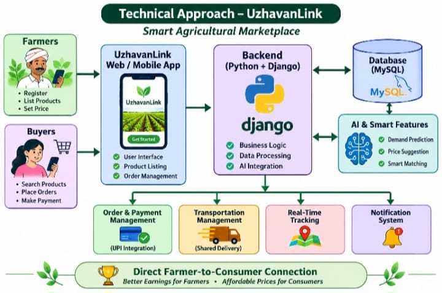

# Smart India Hackathon Workshop
# Date: 25/11/2026
## Reference Number: 26019050
## Name: S Lakshika 

## Problem Title
Multiple Intermediaries Reduce Farmers' Earnings and Increase Consumer Prices

Proposed Project Name: UzhavanLink – Direct Farmer-to-Consumer Marketplace

## Problem Creater's Organization
Smart India Hackathon (SIH)

The specific problem-statement provider organization is not visible in the given screenshot. Verify its name from the SIH problem-statement portal before submission.

 Theme

Agriculture, FoodTech & Rural Development

## Problem Description
Agriculture plays an important role in India's economy. However, farmers face difficulties in receiving a fair price for their agricultural products because of multiple intermediaries involved in the supply chain.

Products pass through local traders, wholesalers, distributors and retailers before reaching consumers. Each intermediary adds additional costs, increasing the final price.

The major problems are:

- Farmers receive lower prices for their products.
- Consumers pay higher prices for agricultural products.
- Farmers have limited access to direct markets.
- Lack of transparent pricing creates unfair trading.
- Delays in transportation cause food wastage.
- Small-scale farmers struggle to find bulk buyers.

Therefore, a digital solution is required to connect farmers directly with consumers and bulk buyers.

## Proposed Solution
We propose UzhavanLink, a digital platform that connects farmers directly with consumers, retailers, hotels and supermarkets.

The main objective is to reduce unnecessary intermediaries and create a transparent agricultural marketplace.

Our proposed platform includes:

1. Direct Farmer Registration: Farmers can register and upload their products, quantities, locations and expected prices.

2. Transparent Pricing: Farmers can compare available market prices and decide a reasonable selling price.

3. Direct Buying and Selling: Consumers and bulk buyers can search for products and place orders directly with farmers.

4. AI-Based Demand Prediction: Artificial Intelligence can analyse previous orders and market trends to predict product demand.

5. Smart Transportation: Nearby farmers can combine their orders and share transportation costs.

6. Regional Language Support: The platform will support Tamil and other Indian languages to make it easier for farmers to use.

7. Order Tracking: Farmers and buyers can track order status and delivery information.

## Technical Approach
The proposed system will use web development, database management and Artificial Intelligence.

Technologies Used:

- Frontend: HTML, CSS and JavaScript
- Backend: Python and Django
- Database: MySQL
- AI/ML: Python and Scikit-learn
- Maps: Google Maps API
- Payment: UPI integration

System Working Process:

1. Farmers and buyers register on the platform.
2. Farmers upload their available agricultural products.
3. Product details are stored in the database.
4. Buyers search for products based on price, location and quantity.
5. The system matches farmers with suitable buyers.
6. AI analyses demand and provides useful market insights.
7. Buyers place orders directly with farmers.
8. Shared transportation is arranged when possible.
9. Payments and order tracking are managed through the platform.

System Architecture:

Farmer / Buyer
↓
UzhavanLink Web or Mobile Application
↓
Backend (Python + Django)
↓
Database (MySQL)
↓
AI-Based Demand Prediction and Smart Matching
↓
Order and Payment Management
↓
Transportation and Delivery
↓
Successful Farmer-to-Buyer Connection

## Feasibility and Viability
Technical Feasibility:

The project can be developed using commonly available technologies such as Python, Django, HTML, CSS and MySQL. AI features can be introduced using Python machine-learning libraries.

Economic Feasibility:

The platform can initially be developed with low-cost or open-source technologies. Shared transportation can help reduce delivery expenses.

Operational Feasibility:

The application will have a simple user interface with regional language support. Farmers can use smartphones to upload products and manage orders.

Viability:

The platform can generate revenue through a small transparent service fee, optional premium services for bulk buyers and partnerships with logistics providers. Basic access for farmers can remain free.

## Impact and Benefits
Benefits to Farmers:

- Better selling opportunities.
- Reduced dependency on unnecessary intermediaries.
- Improved access to direct buyers.
- Better price transparency.
- Reduced transportation expenses.

Benefits to Consumers:

- More affordable agricultural products.
- Access to fresh farm products.
- Transparent product prices.
- Direct connection with farmers.

Benefits to Society:

- Reduction in food wastage.
- Support for small-scale farmers.
- Improved agricultural supply-chain management.
- Development of rural digital technology.
- Stronger connections between farmers and consumers.

Expected Impact:

UzhavanLink aims to improve farmers' income opportunities while reducing unnecessary costs in the agricultural supply chain.

## Research and References
Development Resources:

- Python – Backend programming.
- Django – Web application development.
- MySQL – Database management.
- HTML, CSS and JavaScript – Frontend development.
- Scikit-learn – Machine learning.
- Google Maps API – Location and transportation support.
- UPI – Digital payment integration.

References:

1. Smart India Hackathon Official Website – https://sih.gov.in/
2. Ministry of Agriculture and Farmers Welfare – https://agriwelfare.gov.in/
3. e-NAM (National Agriculture Market) – https://www.enam.gov.in/
4. Digital India – https://www.digitalindia.gov.in/
5. Django Documentation – https://docs.djangoproject.com/
6. Python Documentation – https://docs.python.org/
